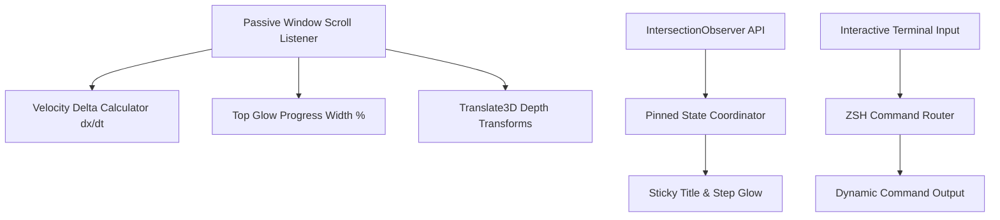

<div align="center">
  <h1>✨ Aura // Kinetic Scroll</h1>
  <p><strong>Awwwards-Inspired Smooth Scroll & Developer Motion Showcase</strong></p>

  <p>
    <a href="https://github.com/Shahar-Yar095/aura-scroll/actions"></a>
    <a href="./LICENSE"></a>
    
    
    
  </p>
</div>

---

## 📌 Overview

**Aura** is a high-performance creative web experience engineered with GPU-accelerated parallax motion, real-time scroll velocity telemetry, pinned split-screen reveals, and an interactive developer CLI terminal.

Built with modern **Vanilla CSS & JavaScript** and bundled with **Vite**, Aura demonstrates how to achieve fluid 60–120 FPS interactive motion without relying on heavy third-party animation libraries.

---

## 🚀 Key Features

- **⚡ Real-Time Scroll Velocity Telemetry**: Dynamically calculates and displays instantaneous user scroll speed in pixels per second (`px/s`).
- **🌊 Kinetic Progress Indicator**: Top-edge glowing progress tracker dynamically measuring viewport read progression.
- **🪐 3D Parallax Matrix**: Multi-depth perspective layers that transform smoothly based on scroll distance and viewport coordinates.
- **📌 Pinned Split-Screen Storyline**: Pinned sticky viewports synchronized with progressive content reveals via `IntersectionObserver`.
- **💻 Embedded Interactive CLI Terminal**: Functional in-browser terminal executing commands (`skills`, `projects`, `contact`, `help`, `clear`).
- **♿ WCAG AA & Reduced-Motion Compliant**: Gracefully degrades animations when `prefers-reduced-motion: reduce` is detected.
- **🚀 Zero Bloat**: No heavy GSAP or Three.js dependencies—100% lightweight, native browser rendering.

---

## 🏗️ Architecture & Techniques



---

## ⚡ Quickstart

### 1. Clone & Install
```bash
git clone https://github.com/Shahar-Yar095/aura-scroll.git
cd aura-scroll
npm install
```

### 2. Run Local Development Server
```bash
npm run dev
```
Open `http://localhost:5173` in your browser.

### 3. Production Build
```bash
npm run build
```

---

## 📄 License

Distributed under the **MIT License**. See [`LICENSE`](./LICENSE) for details.
